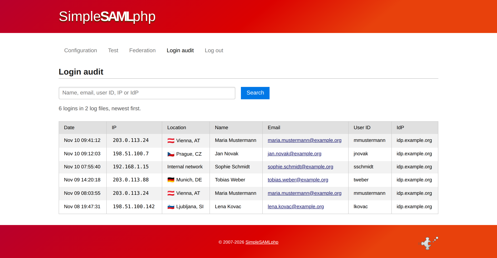

# SimpleSAMLphp loginaudit module

Adds a **Login audit** tab to the SimpleSAMLphp admin interface. It lists
`AUDIT-LOGIN` entries from the SimpleSAMLphp log (active and rotated files) with
search, pagination and cached IP geolocation. It also provides a webcron endpoint
for daily log rotation and retention.



## Requirements

- SimpleSAMLphp 2.x with the `admin` module
- PHP 8.3+, `ext-pdo` (and `ext-pdo_sqlite` for the IP location cache)

## Installation

```bash
composer require eiclu/simplesamlphp-module-loginaudit
```

Or copy this directory to `modules/loginaudit/` (or your custom module directory),
then enable the module in `config/config.php`:

```php
'module.enable' => ['loginaudit' => true],
```

Copy `config-templates/module_loginaudit.php` to your `config/` folder and adjust it.
Clear SimpleSAMLphp's cached routes in `tempdir` after installing or updating.

## Writing the audit log

Enable the bundled authproc filter so every successful login is logged. Add it to
`authproc.idp` (or `authproc.sp`) in `config/config.php`, or to the metadata of a single IdP/SP:

```php
'authproc.idp' => [
    90 => [
        'class' => 'loginaudit:Audit',
        'user_attribute' => 'uid',          // default: uid
        'name_attribute' => 'displayName',  // default: displayName
        'email_attribute' => 'mail',        // default: mail
    ],
],
```

The filter writes lines like this at `NOTICE` level (the SimpleSAMLphp default). Make sure your logging level
(`logging.level`) is `NOTICE` or more verbose:

```
Nov 10 12:00:00 host NOTICE [track] AUDIT-LOGIN: user="…" name="…" email="…" idp="…" ip="…"
```

The module reads exactly this format, so lines written by your own code work as well.
Place the filter after the one that sets the attributes it reads.

## Log rotation (webcron)

Set a long random `rotate_token` in `module_loginaudit.php`, then call:

```
https://<host>/<base>/module.php/loginaudit/rotate?token=<rotate_token>
```

once per day. It copies the active log to `<name>-YYYY-MM-DD.log`, truncates the
active log, and deletes archives older than `retention_days` (default 120, which
satisfies SIRTFI's ≥ 90 days and GDPR's ≤ 180 days guidance). The endpoint is
disabled while `rotate_token` is empty.

## Tests

The integration tests start a real SimpleSAMLphp (installed as a dev dependency) with PHP's
built-in web server. The same installation acts as test SAML IdP and SP, and the tests run
a full browser-style login against it:

- **Log writing:** a successful SAML login writes an `AUDIT-LOGIN` line (filter attached to the IdP
  and, in a second run, to the SP), a failed login does not, and the entries show up in the admin tab.
- **Log rotation:** the webcron endpoint archives the log, appends on a second run the same day,
  prunes archives older than `retention_days`, and rejects a wrong or unset token.

```bash
composer install
vendor/bin/phpunit
```

Requires PHP 8.3+ with the `bcmath`, `curl`, `intl`, `mbstring`, `openssl` and `xml` extensions.
The tests also run in GitHub Actions (`.github/workflows/ci.yml`).

## Privacy

Unknown IPs are sent to ip-api.com for geolocation. Set `'geo_lookup' => false` to
use only the local cache.

## License

LGPL-2.1-or-later, the same license as SimpleSAMLphp. See [LICENSE](LICENSE).
